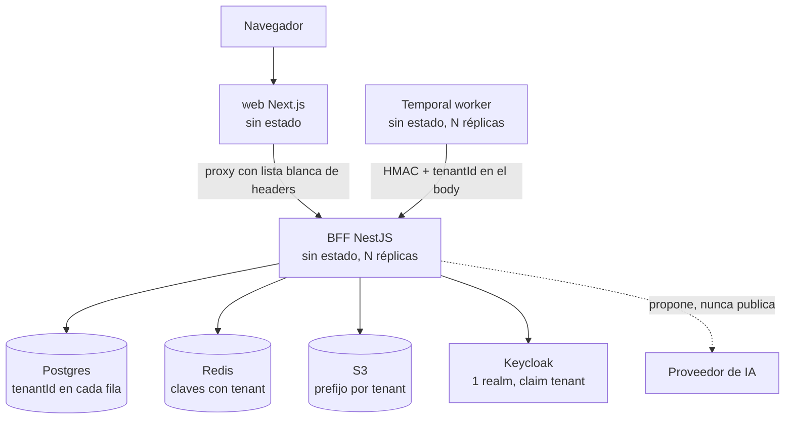

# Arquitectura multitenant y de escala de Prestige

Evaluación del código al 2026-10-15 contra dos objetivos: **1) multitenant estricto** y **2) escalable horizontalmente**.
Este documento dice qué se verificó, qué quedó hecho, qué quedó parcial y qué sigue pendiente. No se declara hecho nada que no se haya probado.

## 1. Modelo

**Tenancy "pool"**: una sola copia de la aplicación sirve a todos los tenants; el aislamiento es lógico, por `tenantId`.
El tenant sale del token (claim `tenant`, slug) y `TenantContextGuard` lo valida contra `TenantMembership` (cierra en falso).
El header `X-Tenant-Id` solo puede elegir entre tenants a los que el usuario ya pertenece.

## 2. Aislamiento por tenant: estado

| Capa | Mecanismo | Estado |
|---|---|---|
| Identidad | Claim `tenant` + membresía; el front rechaza tokens sin claim en producción | Hecho |
| Filas de negocio | `tenantId` obligatorio en servicios; sin tenant devuelven vacío o 404 (antes omitían el filtro) | Hecho en cases, solicitudes, evidencia, inbox, documentos, onboarding |
| Flujos y procesos | `ProcessDefinition.tenantId`; `platform` = semillas de solo lectura; editar una crea copia propia | Hecho (migración aplicada y probada en el stack) |
| Caché y contadores | Claves con tenant: procesos, cuota de IA, idempotencia, presencia | Hecho |
| Objetos S3 | `<tipo>/<tenant>/…` y `assertTenantKey`; se toleran con aviso 3 formatos antiguos | Parcial: falta backfill de claves antiguas y validar dentro de `getObject`/`deleteObject` |
| Cifrado | DEK por objeto; llave maestra global con `kid` y AAD de tenant listos | Parcial: el AAD no se activa de punta a punta (pasar tenant a `putObject`/`getObject`) |
| Firma digital | P12 por tenant; en producción no se autogenera la CA | Parcial: CA única; falta CA intermedia por tenant |
| Evidencia | Clave Ed25519 del manifiesto global; en producción no emite sin firma | Parcial: falta `keyId` por tenant |
| Workflows | `${tenant}:${proceso}:${solicitud}` y memo `tenantId`; los en curso conservan su id | Parcial: una sola task queue (sin equidad entre tenants) |
| Canal worker → BFF | `tenantId` firmado en el body y comparado con la solicitud (403 si no coincide) | Parcial: secreto compartido único |
| Límites | Rate limit `tenant:actor`; cuota de IA por tenant; semáforo de OCR y biometría | Parcial: falta cuota de almacenamiento y de solicitudes por tenant |
| Observabilidad | `tenantId`, `actorId` y `x-correlation-id` en cada línea de log | Hecho; falta `tenant.id` en los spans y métricas por tenant |
| Ciclo de vida | Alta con políticas por defecto; suspender (pausa webhooks, DLQ) y reactivar | Hecho; **exportar y purgar no existen** |
| Front | `QueryClient` se limpia al cambiar de tenant o usuario; proxy con lista blanca y `no-store` | Hecho; branding fijo "SeguriData" sin resolver |

**Sin RLS en Postgres.** El aislamiento depende de que cada consulta filtre. Red de seguridad: la extensión `src/prisma/tenant-guard.ts` rechaza (`TENANT_GUARD=enforce`; por defecto solo en tests, `log` fuera) lecturas/escrituras masivas y altas sin `tenantId` (ver ADR-004). RLS sigue pendiente.

`tenantId` es NOT NULL en todas las tablas de negocio salvo `UserNotification` (11 filas huérfanas sin tenant determinable; revisión manual). `OutOfOffice` es único por `(tenantId, userId)`.

## 3. Escala horizontal: estado

Sin estado y listos para réplicas: BFF, worker y front. El estado vive en Postgres, Redis y S3.

Hecho: leases en Redis con latido para los ticks (sin transacción abierta durante I/O externo); entregas de webhook reclamadas antes del fetch;
anti-replay del worker en Redis; presencia en Redis; `/operations/health/live` y `/ready` (503 si falla Postgres); límites y tiempo de gracia del worker;
paginación opcional en `GET /drive/contents`; interceptor `Idempotency-Key` (Redis, por tenant y actor); `Dockerfile` del front; base de Kubernetes en `deploy/k8s`.

Cuellos de botella esperados, en orden:
1. **PKI en disco local**: con varias réplicas hay que montarla como Secret o pasar a KMS/PKCS#11 (`KEY_CUSTODIAN=pkcs11`).
2. **OCR y biometría dentro de la petición**: hoy acotados con semáforo (503 si se llena); lo correcto es una actividad de Temporal.
3. **Estampado de PDF y cifrado AES en el hilo principal**: bloquean el event loop con PDFs grandes.
4. **Conexiones a Postgres**: dimensionar `connection_limit` por réplica o usar PgBouncer en modo transacción.
5. **Índices**: `WorkflowRun(status, updatedAt)` y `(tenantId, createdAt)` en solicitudes, documentos y auditoría ya existen (migración 20261016100000).
6. **Listados del front sin paginación ni virtualización**: pide parámetros `limit`/`cursor` que hoy casi ningún endpoint tiene.

## 4. Decisiones (ADR)

**ADR-001 Pool, no silo.** Una copia de la app para todos. Más barato y simple de operar; el costo es que el aislamiento es responsabilidad del código.
Para un cliente que exija aislamiento físico: despliegue aparte (namespace y base propios) con la misma imagen, o worker dedicado por tier.

**ADR-002 El tenant sale del token, no del cliente.** El header solo selecciona entre membresías existentes. Alternativas descartadas: subdominio por tenant, realm por tenant.

**ADR-003 Las definiciones de proceso pertenecen a un tenant o a `platform`.** Antes eran un catálogo global que cualquier admin podía alterar. Costo: la migración atribuye los flujos existentes al tenant del formato que los usa o a `seguridata`; revisar en bases con varios tenants.

**ADR-004 Defensa en profundidad: RLS antes de abrir a más tenants.** Propuesta: `SET LOCAL app.tenant` por transacción con políticas RLS en las tablas con `tenantId`, y una extensión de Prisma que falle si una consulta a un modelo con tenant no lo incluye. Hecho solo la extensión de Prisma (`tenant-guard.ts`): valida `tenantId` en `findMany/findFirst/count/aggregate/groupBy/updateMany/deleteMany` y en altas; no valida operaciones por `id`/unique (se cargan antes con tenant). RLS NO se hizo: exige que toda consulta corra en una transacción con contexto (el pool no garantiza la misma conexión) y que ticks y worker usen un rol que la omita; implementarlo ahora rompería las consultas existentes.

**ADR-005 Leases en Redis para los ticks.** El lock de advisory de Postgres retiene una conexión mientras corre el trabajo. Alternativa descartada: lock de sesión (el pool de Prisma no garantiza la misma conexión). Sin Redis se cae al lock transaccional.

**ADR-006 La IA propone y nunca publica.** Todo entra como borrador y pasa por `validateFlow`/`parseTemplateMeta`; los datos personales se enmascaran y la cuota es por tenant. Pendiente de legal: que los textos puedan salir al proveedor.

**ADR-007 Purga de tenants por jobs, con cripto-borrado.** Diseño: suspender → exportar → ventana de retención → purga por job de Temporal con registro de auditoría. Solo el primer paso existe; la purga es destructiva y requiere aprobación explícita.

## 5. Pendiente, por prioridad

**Alta**
- RLS (ADR-004): la extensión de Prisma ya existe; falta activar `TENANT_GUARD=enforce` fuera de tests cuando los logs salgan limpios, y RLS con `SET LOCAL app.tenant`.
- `UserNotification.tenantId` sigue nullable: resolver las 11 filas huérfanas y contraer.
- PKI fuera del disco local (Secret o KMS) antes de la segunda réplica.
- Aprobación de legal para enviar texto de documentos al proveedor de IA.

**Media**
- Activar el AAD de tenant y validar el tenant dentro de `getObject`/`deleteObject`; backfill de claves S3 antiguas.
- Cola de Temporal por tier y secreto de worker por entorno.
- Mover OCR, biometría y estampado de PDF a Temporal.
- Índices de base de datos y PgBouncer.
- Cuota de almacenamiento y de solicitudes por tenant.
- Branding por tenant (hoy fijo) y `tenant.id` en spans y métricas.

**Baja / infraestructura**
- Exportar y purgar tenants (ADR-007).
- Keycloak en modo producción (hoy `start-dev` con admin/admin y usuarios demo), Temporal con autenticación, MinIO sin root.
- CI que construya y escanee las imágenes. Los manifiestos de `deploy/k8s` **no se aplicaron a un clúster**; solo se validó que los YAML parseen.

## 6. Variables nuevas

`DEFAULT_TENANT_SLUG`, `STORAGE_ACTIVE_KID`, `STORAGE_MASTER_KEY_<KID>`, `XAI_API_KEY`, `AI_MODEL`, `AI_RPM_PER_TENANT`, `AI_MONTHLY_PER_TENANT`,
`THROTTLE_{UPLOAD,ONBOARDING,AI}_{LIMIT,TTL_MS}`, `OCR_MAX_CONCURRENCY`, `OCR_MAX_QUEUE`, `BIOMETRIC_MAX_CONCURRENCY`, `BIOMETRIC_MAX_QUEUE`,
`TEMPORAL_MAX_CONCURRENT_ACTIVITIES`, `TEMPORAL_MAX_CACHED_WORKFLOWS`, `TEMPORAL_SHUTDOWN_GRACE_SECONDS`, `KEEP_ALIVE_TIMEOUT_MS`, `HEADERS_TIMEOUT_MS`, `NEXT_OUTPUT`.
